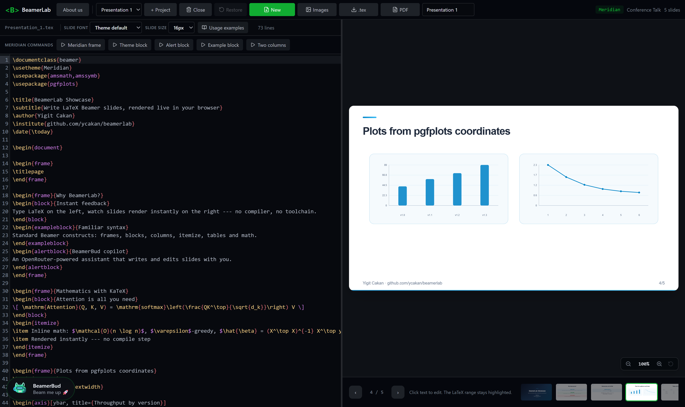
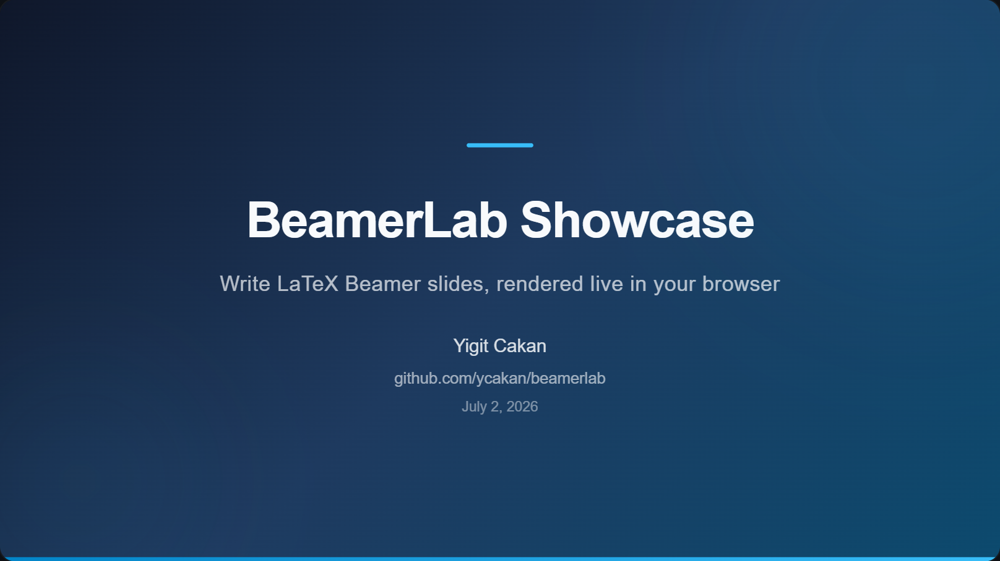
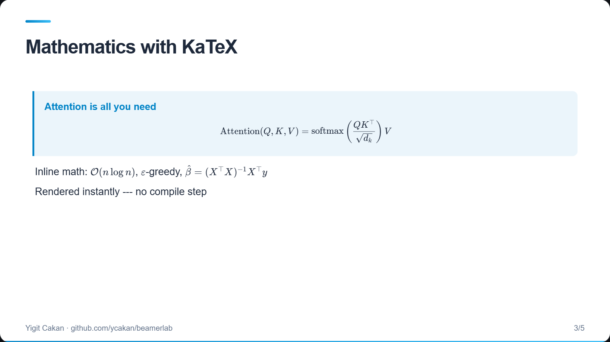
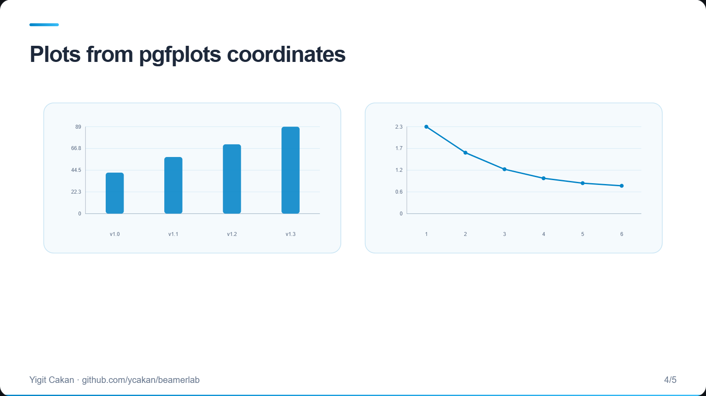
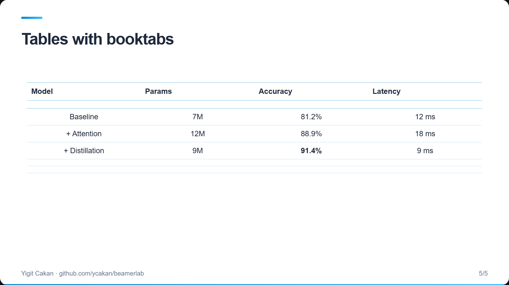
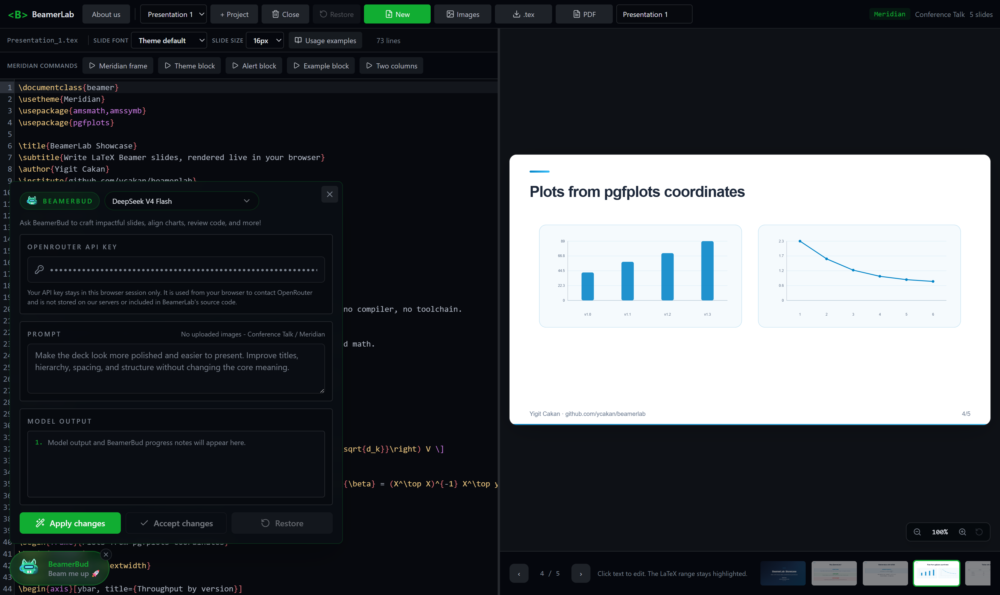

# BeamerLab

**Write LaTeX Beamer slides in your browser and watch them render live — no TeX toolchain required.**

🔗 **Try it now: [beamerlab.lovable.app](https://beamerlab.lovable.app/)**

BeamerLab is a modern LaTeX presentation editor built by ETH Zurich students who spent too many late nights fighting with math equations in slides, broken figures, and mysterious spacing issues. Type standard Beamer LaTeX on the left, see the finished slide on the right — instantly, on every keystroke.



*Your ideas, without the friction.*

## Features

### ⚡ Instant live preview
No compiler, no packages to install, no waiting. BeamerLab renders a practical subset of Beamer directly in the browser:

- **Frames & title pages** — `\begin{frame}`, `\titlepage`, `\title`, `\author`, `\institute`
- **Blocks** — `block`, `alertblock`, `exampleblock` with proper theme styling
- **Math** — inline `$...$` and display math, `equation`/`align`, rendered with KaTeX
- **Layout** — `columns`, `itemize`, `enumerate`, `center`
- **Tables** — `tabular` with booktabs rules (`\toprule`, `\midrule`, `\bottomrule`)
- **Plots** — pgfplots `axis` environments with `\addplot coordinates` become real charts: bar, line, area, scatter, and more
- **Images** — upload figures and place them with `\includegraphics`

Click any text on a rendered slide and the matching LaTeX range is highlighted in the editor.

All of the slides below were written in plain Beamer LaTeX and rendered by BeamerLab in the browser:

| | |
|:---:|:---:|
|  |  |
| *Themed title page* | *Display & inline math via KaTeX* |
|  |  |
| *Bar & line charts from `\addplot coordinates`* | *`tabular` with booktabs rules* |

### 🎨 13 templates, fully customizable
Purpose-built themes for research, teaching, academia, and industry — Conference Talk, Graduate Lecture, Dark Research, Thesis Defense, Workshop Talk, Poster Lightning Talk, Lab Group Meeting, Systems Architecture, Grant Proposal, Startup Pitch, Security Briefing, Project Plan — plus a custom template where you pick your own slide and command colors with a color wheel.

### 🤖 BeamerBud — your slide copilot
Hit **"Beam me up 🚀"** and BeamerBud helps you craft impactful slides, align charts, and review your LaTeX. It runs on [OpenRouter](https://openrouter.ai/), so you choose the model: GPT, Claude, Gemini, Grok, or DeepSeek.

- Bring your own OpenRouter API key — it **stays in your browser session only**, is sent directly from your browser to OpenRouter, and is never stored on any server or included in BeamerLab's source code
- Review every suggestion before it lands: **Apply → Accept** or **Restore** to roll back



### 💾 Local-first projects
Work on multiple presentations side by side. Projects are cached in your browser — close the tab and pick up where you left off. Export your work as a `.tex` file (compile it with a full LaTeX toolchain any time) or as a PDF.

## Quick example

Paste this into a new project to see plots, math, and tables render live:

```latex
\begin{frame}{Plots from pgfplots coordinates}
\begin{columns}
\begin{column}{0.5\textwidth}
\begin{tikzpicture}
\begin{axis}[ybar, title={Throughput by version}]
\addplot coordinates {(v1.0, 42) (v1.1, 58) (v1.2, 71) (v1.3, 89)};
\end{axis}
\end{tikzpicture}
\end{column}
\begin{column}{0.5\textwidth}
\begin{tikzpicture}
\begin{axis}[title={Validation loss}, xlabel={epoch}]
\addplot coordinates {(1, 2.31) (2, 1.62) (3, 1.18) (4, 0.94) (5, 0.81)};
\end{axis}
\end{tikzpicture}
\end{column}
\end{columns}
\end{frame}
```

## Running locally

```bash
bun install        # or: npm install
bun run dev        # or: npm run dev
```

The dev server starts at `http://localhost:8080`.

Other scripts: `build` (production build), `preview`, `lint`, `format`. The project deploys to Cloudflare Workers via the included `wrangler.jsonc`.

## Tech stack

React 19 · TanStack Start & Router · Vite 7 · Tailwind CSS 4 · shadcn/ui · CodeMirror 6 · KaTeX · Cloudflare Workers

## A note on rendering

BeamerLab renders a curated subset of Beamer for fast, faithful previews — it is not a full TeX engine. For final camera-ready output, export your `.tex` file and compile it with your favorite LaTeX distribution or hit the PDF export button! Your source stays 100% standard Beamer either way.

## Support BeamerLab

If BeamerLab is useful to you, ⭐ starring the repo helps more students, researchers, and contributors discover it.

## License

[MIT](LICENSE)
